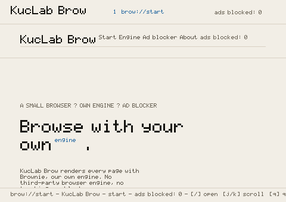
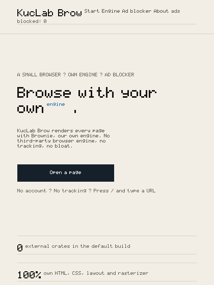
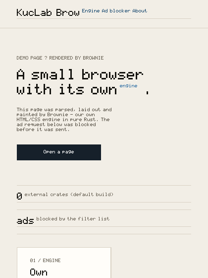

# KucLab Brow

A smooth, modern, **bloat-free browser with its own rendering engine** and a built-in **ad blocker**.

**Naming:** the browser is **KucLab Brow** (binary `brow`); its engine is **Brownie** (crate `brownie`).

Everything you see is rendered by **Brownie** (`brownie`) - our own HTML parser, CSS cascade,
layout engine, software rasterizer and PNG encoder - written in pure Rust with
**zero external dependencies**. No Blink, no WebKit, no bloat.

## Features (v0.1)

- Own HTML parser (elements, attributes, entities, void/raw-text elements, implied end tags)
- Own CSS parser + cascade (UA sheet, author sheets, inline styles, specificity)
- Own layout engine: block + inline boxes, word wrap, text-align, margins/padding/borders
- Own software rasterizer with a built-in bitmap font (no system fonts needed)
- Own PNG encoder (zlib stored blocks) - screenshots without any image crate
- Own HTTP/1.1 client (redirects, chunked encoding) + `file://` support
- Own ad blocker: hosts-style entries, `||domain^` anchored patterns, `*/ads/*` wildcards, `@@` exceptions
- Terminal shell: tabs, address bar, scrolling, screenshots
- HTTPS via the optional `tls` feature (rustls + webpki roots - TLS is the one
  thing we deliberately do not hand-roll): `cargo build --release -p brow --features tls`

## Design

KucLab Brow follows the **Gerin Paper Design v2** rules, adapted to a terminal/own-engine
browser (see `engine/src/theme.rs` for the tokens): paper background `#f2eee6`, surface
`#fffdf9`, 1 px hairlines `#d9d1c4`, ink `#1c1b18`/`#14130f`, muted `#5b554a`, one accent
blue `#2b6ca3`, dark button `#16202a`. No gradients, no purple, no emoji, no glow; copy uses
plain hyphens (`-`), never em dashes; one primary action per screen.

The browser chrome (header with wordmark `KucLab Brow`, centered tabs, hairline rules, URL
input on a surface, muted footer) and the built-in start page (`shell/assets/start.html`)
are styled with the same tokens.

Samples (PNG, rendered by Brownie itself):







Regenerate with: `brow --frame-shot docs/samples/ui.png` and
`brow --screenshot "file://$PWD/shell/assets/start.html" docs/samples/start.png --width 420 --height 560`

## Performance

Measured with `brow --bench URL --iterations N` (release build, 1 MB page with
8 000 sections):

| stage  | before | after hardening/optimization |
|--------|--------|------------------------------|
| parse  | ~107 MB/s | ~100 MB/s |
| layout | **1.35 s** | **~58 ms** (UA sheet cached, styles memoized per element) |
| paint (320x2000 viewport) | 23 ms | **~0.7 ms** (span-based fills + viewport culling) |

```sh
brow --bench file:///path/to/big.html --iterations 20 --width 320 --height 2000
```

## Security model

- **Resource limits everywhere**: URL ≤ 4096 B, response headers ≤ 64 KB,
  body ≤ 32 MB (also enforced for chunked), ≤ 5 redirects, connect/read
  timeouts, DOM depth ≤ 512, CSS rules ≤ 10 000, filter rules ≤ 250 000,
  patterns ≤ 1 KB, framebuffer ≤ 64 Mpx - hostile input can't exhaust memory
  or hang the engine (regression-tested in `engine/tests/security.rs`).
- **Same-origin policy**: subresources (`<link>`, `<script>`, ``, ...)
  are only fetched from the page's own origin - a remote page cannot read
  `file://` or other origins through us.
- **No https→http downgrade** on redirects.
- **Ad blocker runs before any connection** - blocked requests are never sent.
- **HTTPS** with rustls behind `--features tls` (default build stays
  zero-dependency); certificate validation via webpki roots, tested against a
  loopback TLS server (`engine/tests/tls.rs`).

## Build & run

```sh
cargo build --release
# with HTTPS:
cargo build --release -p brow --features tls

# interactive terminal browser
./target/release/brow https://example.com

# headless helpers
./target/release/brow --screenshot https://example.com shot.png --width 480 --height 600 --scale 2
./target/release/brow --dump-dom https://example.com
./target/release/brow --dump-layout https://example.com --width 80
./target/release/brow --fetch https://example.com

# try the bundled demo page locally (ads.js / ads/banner.png get blocked)
./target/release/brow --screenshot "file://$PWD/demo/site/index.html" demo.png --width 320 --height 400 --scale 2
```

Ad-block filters default to `./filters/blocklist.txt` (override with `--filters PATH`,
disable with `--no-adblock`).

## Architecture

```
shell/    brow binary - terminal UI (tabs, URL bar) + CLI modes
engine/   brownie library (the Brownie engine)
  html.rs     HTML tokenizer + tree builder (arena DOM)
  css.rs      CSS parser, selectors, colors
  style.rs    UA stylesheet + cascade -> computed style
  layout.rs   box tree + block/inline layout with word wrap
  font.rs     built-in 5x7 bitmap font
  paint.rs    RGBA framebuffer rasterizer
  png.rs      PNG encoder
  net.rs      HTTP/1.1 client, redirects, chunked, file:// (+ optional tls feature)
  adblock.rs  filter-list engine (hosts, ||anchored, wildcards, @@exceptions)
  theme.rs    design tokens (Gerin Paper Design v2, adapted): paper/ink palette
demo/     local demo site
filters/  default blocklist
```

## Roadmap

1. Packaging, in this order: **.rpm → .apk → .exe → .deb**
2. Image decoding (PNG/JPEG) into the rasterizer
3. JavaScript engine (own interpreter)
4. GUI shell (native window) + per-tab process sandboxing on top of the same engine
5. More CSS (flex/grid, floats, margin collapsing), HTTP/2, cache

See `docs/ARCHITECTURE.md` for engine details.

## License

Apache-2.0 (see `LICENSE`).
